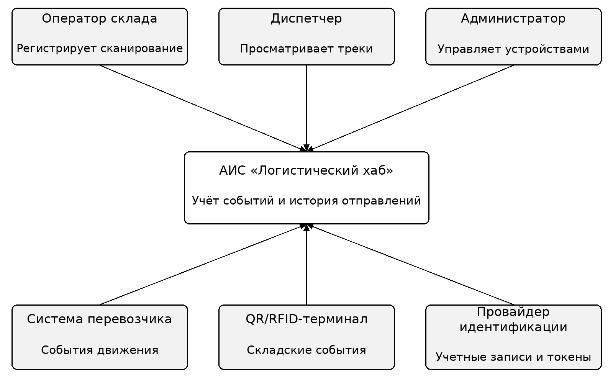
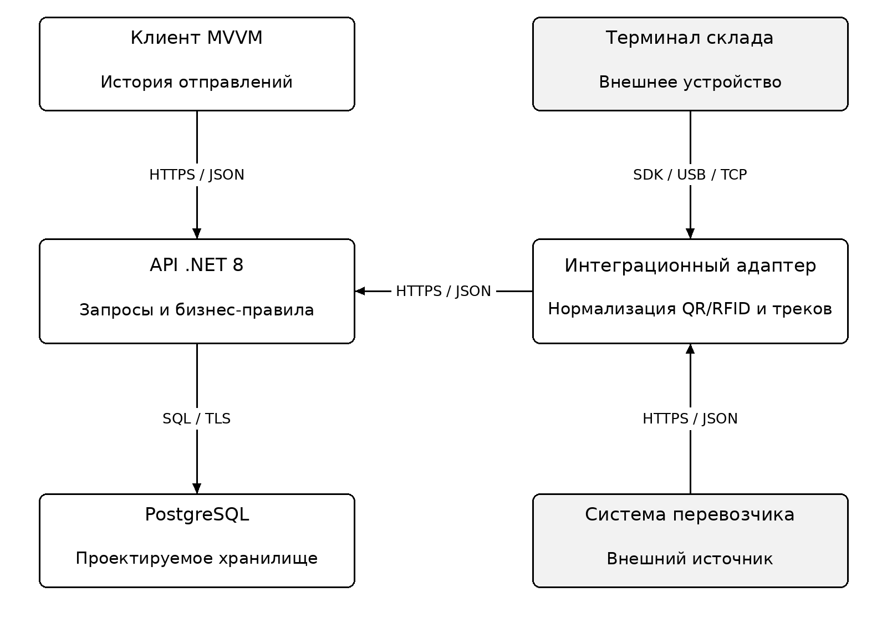
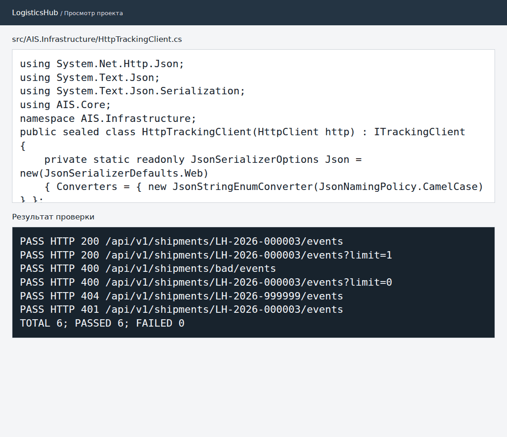

# Практическая работа № 2. Уровни интеграции модулей

**МДК.02.02, вариант 3.** АИС «Логистический хаб».

## Уровни интеграции

| Уровень | Решение |
| --- | --- |
| Приложения | Клиент запрашивает историю отправления через API. Адаптер принимает события внешних систем. |
| Данные | Адаптер приводит события перевозчика и складских терминалов к единой модели: источник, идентификатор события, отправление, статус и время. |
| Процесс | Склад и перевозчик дополняют историю отправления, диспетчер получает её по трек-номеру. |

## Границы системы

**C4 Level 1.** Оператор склада, диспетчер и администратор работают с АИС. Перевозчик и QR/RFID-терминал передают события. Провайдер идентификации входит в целевой контур.

**C4 Level 2.** Клиент MVVM обращается к API .NET 8. Интеграционный адаптер преобразует данные внешних источников. PostgreSQL предусмотрен как целевое хранилище.

В проверенном прототипе адаптер — библиотека внутри API, история хранится в памяти. PostgreSQL, отдельный процесс адаптера и внешний провайдер идентификации не развёртывались.

## Проверка прототипа

Проверен маршрут `GET /api/v1/shipments/{trackingNumber}/events`. Все шесть HTTP-сценариев вернули ожидаемый код: 200 для чтения, 400 для неверных параметров, 404 для неизвестного отправления и 401 для запроса без авторизации.

- [Протокол с результатами](http-results.txt)
- [Ответы API в JSON](http-results.json)
- [Спецификация OpenAPI](../contracts/openapi.yaml)
- [Клиент истории отправлений](../../src/AIS.Infrastructure/HttpTrackingClient.cs)
- [Точка входа API](../../src/AIS.Api/Program.cs)
