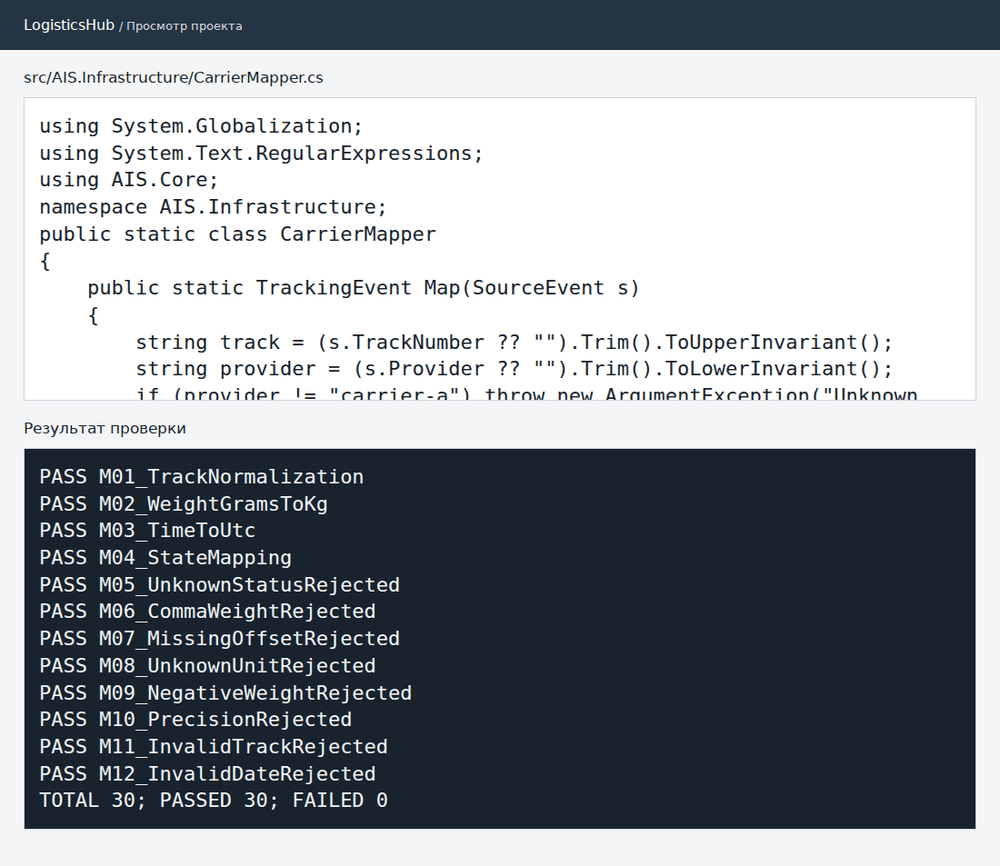

# Практическая работа № 3. Сопоставление данных (Data Mapping)

**МДК.02.02, вариант 3.** АИС «Логистический хаб».

| Входные данные | Преобразование |
| --- | --- |
| Трек-номер | Удаление крайних пробелов и нормализация регистра. |
| Статус перевозчика | Преобразование к перечислению состояний проекта. |
| Время с часовым смещением | Перевод в UTC; время без смещения отклоняется. |
| Масса и единица измерения | Перевод граммов в килограммы; неизвестные единицы отклоняются. |
| Источник и номер события | Совместный ключ, по которому выявляются повтор и конфликт. |

Позднее событие сохраняется в истории и не меняет более свежий статус. Например, в ответе API событие содержит массу `1.25` кг и время `2026-11-04T06:00:00+00:00`.

- [Маппер](../../src/AIS.Infrastructure/CarrierMapper.cs)
- [Хранилище событий](../../src/AIS.Infrastructure/InMemoryTrackingRepository.cs)
- [16 проверок преобразования и хранения](checks.txt)
- [Пример ответа API](../pr2/http-results.json)

