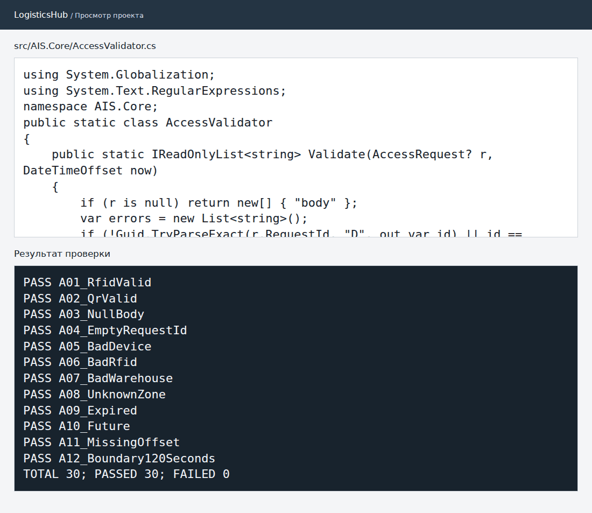

# Практическая работа № 4. Контракты доступа и валидация

**МДК.02.02, вариант 3.** АИС «Логистический хаб».

Спроектирован JSON-запрос на проверку прохода в зону склада. Валидатор проверяет идентификаторы запроса и устройства, тип и формат метки, склад, зону и допустимое время запроса. Корректный формат не означает разрешение на проход: право доступа проверяется отдельно.

| Случай | Результат по контракту |
| --- | --- |
| Поле запроса некорректно | 400, код ошибки валидации. |
| Нет действительного токена | 401. |
| Устройство не имеет нужной области доступа | 403. |
| Запрос корректен, но проход в зону запрещён | 200 с решением `deny`. |

Маршрут контроля прохода описан проектом. В прототипе реализован и проверен валидатор полей.

- [Контракт JSON](../contracts/access-request.json)
- [Валидатор](../../src/AIS.Core/AccessValidator.cs)
- [12 проверок валидации](checks.txt)

