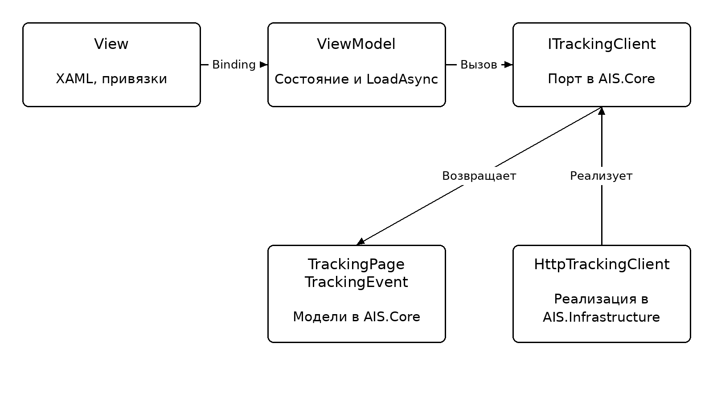
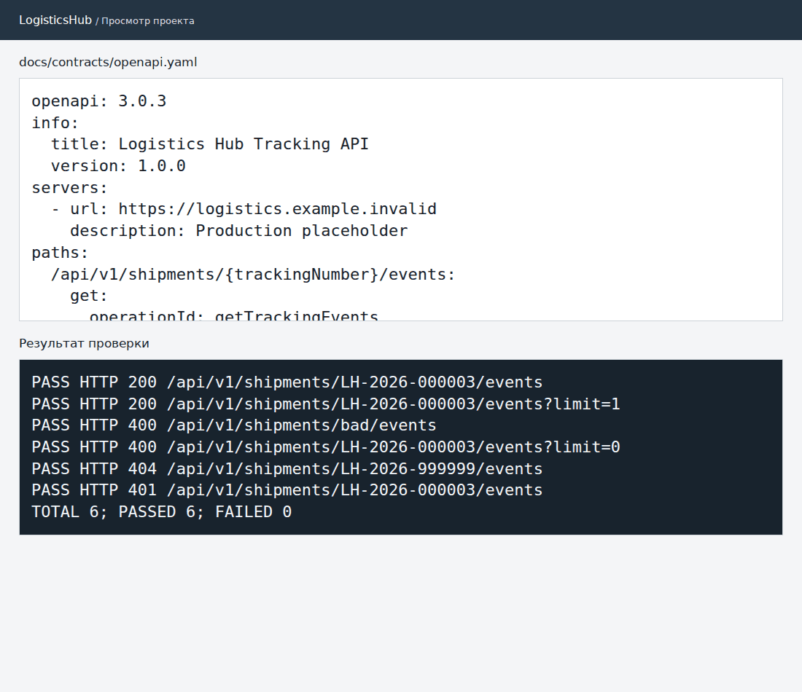

# Практическая работа № 6. Клиентская архитектура и OpenAPI

**МДК.02.02, вариант 3.** АИС «Логистический хаб».

Клиент разделён по MVVM: View описывает представление, ViewModel хранит состояние загрузки и ошибки, HTTP-адаптер получает историю по контракту. XAML — макет представления.

- [Спецификация OpenAPI](../contracts/openapi.yaml)
- [ViewModel](../../src/AIS.UI/TrackingViewModel.cs)
- [Макет представления](../../src/AIS.UI/Views/TrackingView.xaml)
- [Шесть HTTP-проверок](../pr2/http-results.txt)
- [Две проверки ViewModel](checks.txt)

