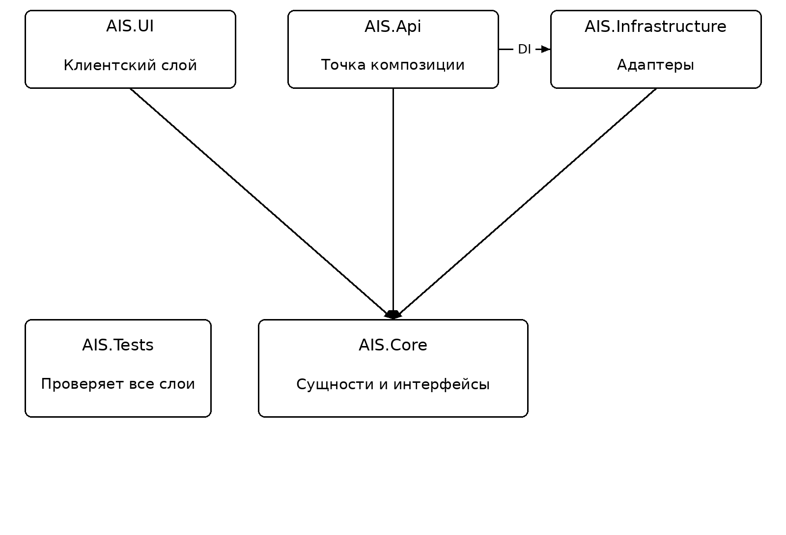
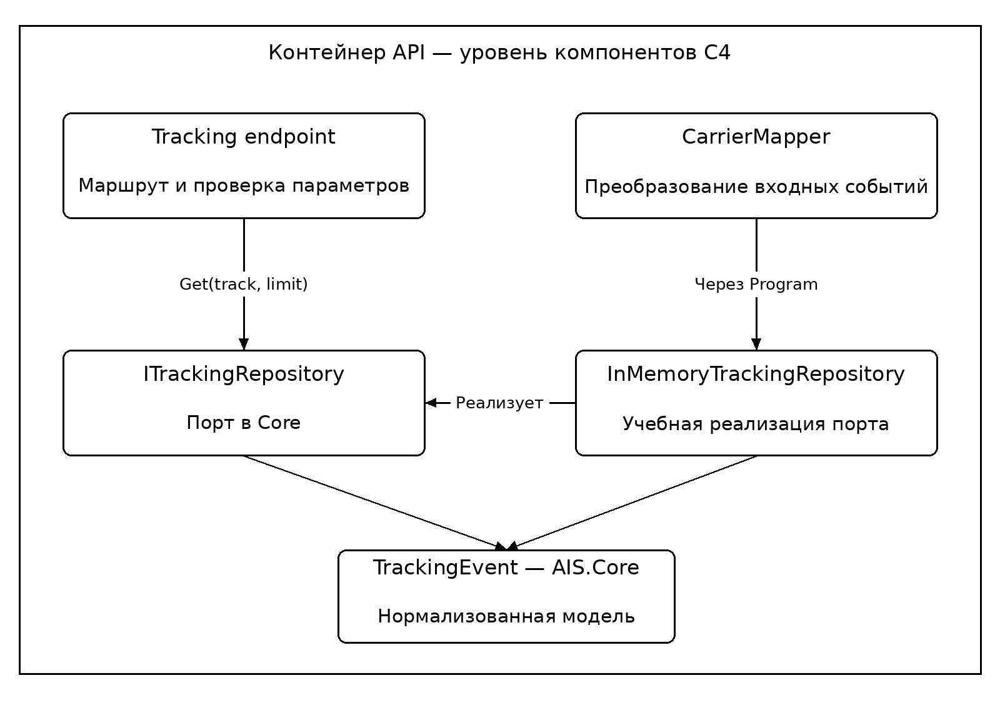

# Практическая работа № 7. Диаграмма модулей и структура проекта

**МДК.02.02, вариант 3.** АИС «Логистический хаб».

Проект состоит из Core, Infrastructure, API, UI и проверок. Core хранит предметную модель и правила; Infrastructure реализует адаптеры, API объединяет их, UI получает данные через контракт. Диаграмма C4 показывает компоненты внутри API.

- [Решение C#](../../LogisticsHub.sln)
- [Протокол сборки](build.txt)
- [30 проверок логики](checks.txt)
- [6 HTTP-проверок](../pr2/http-results.txt)
